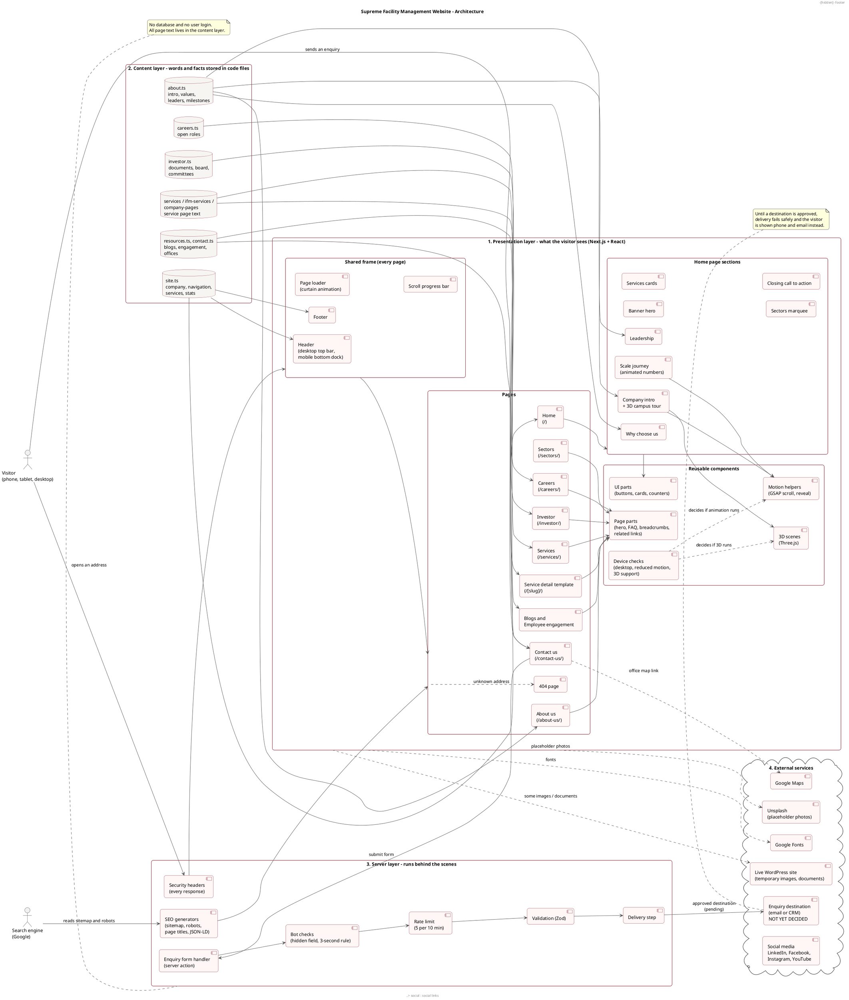

# Supreme Facility Management Website: Architecture

**Purpose of this file.** It describes how the Supreme Facility Management website is built, in plain language first and technical detail second. It is written so that:

- a non-technical colleague can understand what the website is made of and how a visitor moves through it, and
- an AI tool (or a designer) can read it and draw an architecture diagram without asking further questions.

Section 13 contains ready-to-render PlantUML code. The same code is saved as `docs/architecture.puml`.

> Status note: the website is a front-end build with no database. One piece is not final: the place enquiry emails are delivered to is still undecided (see section 8).

---

## 1. The website in one paragraph

The website presents Supreme Facility Management (founded 1983, part of the L. V. Shinde Group). It tells visitors what the company does (five services), who it serves (sectors), who runs it (leadership), and how to reach it. It also serves investors (documents and governance) and job seekers (open roles). Visitors can send an enquiry through a contact form. The site is built to be fast, work on every device from phones to large desktop screens, and be findable on Google.

---

## 2. Think of the website as a building

| Part of a building | What it is on the website | Plain meaning |
|---|---|---|
| **The visitor** | Browser on phone, tablet or desktop | The person walking in |
| **The front door and signboard** | Header (menu), loader animation, footer | What every page shares |
| **The rooms** | Pages: Home, About, Services, Sectors, Investor, Careers, Contact, Blogs, Employee Engagement | Where visitors spend time |
| **The furniture** | Reusable components: buttons, cards, hero banners, FAQ lists | Pieces reused in many rooms |
| **The filing cabinet** | Content files holding all text, service details, jobs, investor documents | Where the words and facts live |
| **The reception desk** | Contact form and its server-side checks | Where enquiries are received and screened |
| **The security guard** | Spam checks, rate limit, security headers | Keeps bots and abuse out |
| **The signage for Google** | SEO files: sitemap, robots, page titles | Helps search engines find the pages |
| **The show floor** | 3D and animated scenes on the home page | The visual "wow" parts |

---

## 3. Technology stack (what it is built with)

| Layer | Technology | Why it is used (plain language) |
|---|---|---|
| Framework | **Next.js 16** (App Router) | Builds fast pages, handles URLs and the form server code |
| UI library | **React 19** + **TypeScript** | Builds the screen from reusable parts; TypeScript catches mistakes early |
| Styling | **Tailwind CSS v4** with custom design tokens | Consistent look: warm off-white page (`#f7f5f2`), white cards, maroon brand colour (`#85182a`) |
| Fonts | Bricolage Grotesque (headings), Instrument Sans (text), via `next/font` | Loaded once, no layout jump |
| Scroll animation | **GSAP** + ScrollTrigger (`@gsap/react`) | Animations that follow the scroll position |
| Small animations | **motion** library | Simple transitions |
| 3D graphics | **Three.js** with **React Three Fiber**, **drei**, **postprocessing** | The 3D campus and building scenes |
| Icons | **lucide-react** | Menu and button icons |
| Form validation | **Zod** | Checks that form entries are valid |
| Class helpers | clsx, tailwind-merge | Tidy styling code |
| Quality tools | ESLint, TypeScript type check | Automatic code checks |

There is **no database and no login system**. All page content is stored in code files inside the project.

---

## 4. High-level architecture (the big picture)

Four layers, from top to bottom:

1. **Visitor layer.** A person on any device opens a web address.
2. **Presentation layer (what the visitor sees).** Next.js builds the page from three kinds of building blocks: the shared layout (header, loader, footer), the page itself, and reusable components.
3. **Content layer (what the pages say).** Text, services, jobs, investor documents and navigation come from content files. Pages read from these files; nobody edits text on the live page.
4. **Server layer (what happens behind the scenes).** Only three things run on the server: the enquiry form handler, the SEO generators (sitemap and robots), and the security headers added to every response.

Outside the website sit **external services**: Google Fonts, the live WordPress site (for some images and documents), Unsplash (placeholder photos), social media links, Google Maps, and the **enquiry destination** (email or CRM, not yet chosen).

---

## 5. Page map (what pages exist)

Every address ends with a `/` because the old WordPress site used that style, so old links keep working.

| Page | Address | What it contains |
|---|---|---|
| **Home** | `/` | Banner hero, company introduction with 3D tour, services, scale (numbers journey), why choose us, sectors, leadership, closing call to action |
| **About us** | `/about-us/` | Overview, purpose, values, leadership grid, milestones, core strengths |
| **Services** | `/services/` | Overview of the five services |
| **Service detail pages** | `/[slug]/`, e.g. `/supply-chain-solutions/`, `/hard-services/` | One template that serves every service, sub-service and company page |
| **Sectors** | `/sectors/` | Industries served, with an interactive carousel |
| **Investor** | `/investor/` | Document library, board, committees, policies |
| **Careers** | `/careers/` | Why join, open role board |
| **Contact us** | `/contact-us/` | Offices, contact channels, enquiry form |
| **Blogs** | `/blogs/` | Blog post list |
| **Employee engagement** | `/employee-engagement/` | Engagement stories and posts |
| **Not found** | any unknown address | Friendly 404 page |

### The five services
1. Integrated Facility Management (sub-pages: hard services, soft services, specialized services, health care, staffing, hospitality)
2. Supply Chain Solutions
3. Employee Transportation Services
4. Corporate Food Solutions
5. Production Support Services

### One template, many pages
Instead of building dozens of separate files, one template file (`src/app/[slug]/page.tsx`) builds every service, sub-service and company page. It reads the page's text from the content files by its address (the "slug"). If the address is not in the content list, the visitor sees the 404 page. This makes adding a new page a matter of adding content, not code.

---

## 6. How the pieces connect (folder by folder)

```
supreme-website/
├── src/
│   ├── app/                 ROOMS and server logic
│   │   ├── layout.tsx       Shared frame: fonts, loader, header, footer, page metadata
│   │   ├── page.tsx         Home page (assembles home sections)
│   │   ├── [slug]/page.tsx  Template for all service / company pages
│   │   ├── about-us/ services/ sectors/ investor/ careers/
│   │   │   contact-us/ blogs/ employee-engagement/   One page each
│   │   ├── contact-us/actions.ts   Server code that receives the enquiry form
│   │   ├── sitemap.ts  robots.ts   Files for search engines
│   │   ├── not-found.tsx    404 page
│   │   └── globals.css      Design tokens (colours, spacing) and shared styles
│   │
│   ├── components/          FURNITURE (reusable parts)
│   │   ├── layout/          site-header (menu, bottom dock on mobile), site-footer
│   │   ├── home/            Home sections: banner-hero, company-intro, services, scale,
│   │   │                    why-choose-us, sectors, leadership, closing-cta
│   │   ├── page/            Shared page parts: page-hero, intro-block, content-sections,
│   │   │                    faq-list, breadcrumbs, related-links, json-ld, scroll-cue
│   │   ├── about/ careers/ contact/ investor/ forms/   Page-specific parts
│   │   ├── motion/          loader, scroll progress bar, reveal-on-scroll, pinned sections
│   │   ├── three/           3D scenes (about-scene, building-scene, hero-canvas)
│   │   ├── day/             Experimental "a day at the campus" 3D scene (currently switched off)
│   │   └── ui/              Buttons, counters, cards, copy button
│   │
│   ├── content/             FILING CABINET (all the words and facts)
│   │   site.ts              Company details, navigation, services list, stats
│   │   about.ts             Intro, values, leaders, milestones
│   │   services.ts / ifm-services.ts / company-pages.ts   Text for each service page
│   │   pages.ts             Combines all page content, looks pages up by address
│   │   careers.ts  investor.ts  resources.ts  contact.ts  Jobs, investor files, blogs, offices
│   │
│   └── lib/                 TOOLBOX (behind-the-scenes helpers)
│       ├── enquiry-schema.ts  enquiry-options.ts  enquiry-delivery.ts  Form rules and delivery
│       ├── rate-limit.ts    Limits how often one network can submit
│       ├── seo.ts           Page titles, canonical addresses, indexing switch
│       ├── motion/          Detects desktop, reduced-motion, and 3D support
│       ├── about/path.ts    Camera path and captions for the home 3D tour
│       └── day/             Helpers for the experimental campus scene
│
├── public/                  Images (logo, sector photos, bus image, hero backgrounds)
├── docs/                    Product and technical requirement documents (PRD, TRD), open decisions
└── next.config.ts           Security headers, trailing slashes, allowed image sources
```

---

## 7. What happens when someone visits a page (request flow)

1. The visitor types an address or taps a link.
2. The **server** (Next.js) finds the matching page. For a service page it uses the template and looks up the text in the content files.
3. The server sends back the page together with **security headers** (they stop the page being embedded in other sites and limit browser permissions such as camera and location).
4. The browser shows a short **loader animation** (a curtain). It is skipped for people who prefer reduced motion.
5. The page appears with the shared **header** on top and **footer** at the bottom.
6. As the visitor scrolls, a **progress bar** fills, sections **reveal** gently, and on the home page the **3D tour** plays.
7. When the visitor moves to another page, the loader curtain plays again for a smooth transition.

### Layout shared by every page
`layout.tsx` wraps every page with: the "Skip to content" link (accessibility), the loader, the scroll progress bar, the header, the page, and the footer. It also sets the site-wide title, description, social-share details, language (`en-IN`), and the Google indexing rule.

---

## 8. The enquiry form (the only "live" feature)

The contact form is the one place where information goes from the visitor to the company. It has several safety steps.

**Steps in order**
1. The visitor fills the form (name, company, email, phone, service of interest, location, message, consent tick).
2. The browser sends it to a **server action** (`contact-us/actions.ts`).
3. **Bot check 1:** a hidden "honeypot" field. Real people never see it, bots fill it. If filled, the form silently pretends to succeed and sends nothing.
4. **Bot check 2:** if the form is submitted within 3 seconds of opening, it is treated as a bot.
5. **Rate limit:** at most 5 enquiries per network address per 10 minutes.
6. **Validation:** Zod checks every field. If something is wrong, the visitor sees which fields to fix.
7. **Delivery:** the checked enquiry is passed to the delivery step.
8. The visitor sees a success or error message. On error the message offers the phone number and email as a fallback.

**Delivery status (important).** The final destination (email service or CRM) is **not decided yet**. In development, a "mock" mode only logs a redacted summary. In production without an approved destination, delivery **fails safely** so no visitor is told "sent" when nothing was sent.

**Known limits:** the rate limiter keeps its count in the server's memory, so it resets on restart. Before launch it should be replaced by a firewall rule or shared store.

---

## 9. The home page experience (the visual highlights)

| Section | What the visitor sees | How it works |
|---|---|---|
| **Banner hero** | Full-screen opening banner | Static image with text and a scroll cue |
| **Company introduction** | Intro text beside a 3D campus tour. As the visitor scrolls, the camera visits the tower, the bus and the cafeteria, and the left text switches to the matching service | Three.js scene driven by scroll progress; the text panels cross-fade. On phones, tablets, reduced motion, or no 3D support, the text becomes a simple list of the five services |
| **Services** | Cards for the five services | Reads from `site.ts` |
| **Scale** | Animated journey with company numbers (states, clients, meals per day, and others) | SVG art with animated counters |
| **Why choose us** | Card grid ("bento") with a static bus image | Reads from `about.ts` |
| **Sectors** | Scrolling marquee and expandable sector cards | Local sector images |
| **Leadership** | Leader highlights | Reads from `about.ts` |
| **Closing call to action** | Final prompt to get in touch | Links to contact page |

**Smart fallbacks.** The site checks the device before running heavy effects. 3D and pinned scrolling run only on capable desktops. Everyone else gets a lighter, fully working version of the same content. Visitors who prefer reduced motion get no animation.

### Navigation by device
- **Desktop (1024 px and wider):** a rounded top navigation bar that hides while scrolling down and returns when scrolling up. Services opens a mega-menu.
- **Phone and tablet (below 1024 px):** a floating bottom dock with Services, Sectors, Investor, Careers and a "More" button that opens a sheet with the remaining pages and the Contact button.

---

## 10. Cross-cutting concerns

| Concern | How it is handled |
|---|---|
| **Responsive design** | Layout adapts from small phones to wide desktops; no sideways scrolling |
| **Accessibility** | Skip link, keyboard-friendly menus, visible focus, hidden panels marked inert, reduced-motion support |
| **Search engines (SEO)** | Per-page title and description, canonical address, `sitemap.xml`, `robots.txt`, structured data (JSON-LD) |
| **Indexing control** | Search engines are **blocked by default** (for staging). Set `ALLOW_INDEXING=true` only in approved production |
| **Security** | Headers on every response (no sniffing, restricted referrer, same-origin framing only, camera/mic/location blocked); no "powered by" header; form spam defences; credentials must stay in server-only environment variables |
| **Performance** | Heavy 3D code loads only when needed; images served as AVIF/WebP; fonts self-hosted at build time |
| **URLs** | Trailing slashes kept to match the old WordPress site |
| **Configuration** | `ENQUIRY_DELIVERY` (mock mode in development) and `ALLOW_INDEXING` (production indexing) |

---

## 11. External connections

| External item | Used for | Notes |
|---|---|---|
| Google Fonts | Heading and body fonts | Fetched at build time |
| Live WordPress site (`supremefacility.com`) | Some images and investor documents | **Temporary.** Images should be moved into `/public` before launch |
| Unsplash | Placeholder photos | **Temporary.** Replace with company-owned photos |
| Google Maps | Office location link | Link only |
| LinkedIn, Facebook, Instagram, YouTube | Social links in footer and pages | Link only |
| Enquiry destination (email or CRM) | Receiving enquiries | **Not decided yet** |
| Hosting platform | Running the site | **Not decided yet** (see `docs/OPEN_DECISIONS.md`) |

---

## 12. Open decisions and known limits

1. Where enquiries are delivered (email provider or CRM) is not chosen.
2. Hosting platform is not chosen, so the rate limiter should be moved to a firewall rule or shared store.
3. Temporary images from the live site and Unsplash need replacing before launch.
4. The home 3D tour has no scene for Supply Chain or Production Support; they appear only in the service list.
5. Some careers roles are shown only when HR has marked them verified (in production).
6. The "day at the campus" 3D scene exists in the code but is switched off on the home page.

---

## 13. PlantUML architecture diagram

Paste this into any PlantUML renderer (plantuml.com, VS Code PlantUML extension, or IntelliJ).



---

## 14. Short glossary

| Term | Meaning |
|---|---|
| **Next.js / React** | The tools that build the website pages |
| **Component** | A reusable piece of a page, such as a button or a card |
| **Slug** | The last part of a page address, for example `supply-chain-solutions` |
| **Server action** | A small program on the server that handles a form |
| **Honeypot** | A hidden form field that only bots fill in |
| **Rate limit** | A cap on how many times one network can send the form |
| **SEO** | Making pages easy for search engines to find |
| **3D scene** | An interactive graphic drawn in the browser with WebGL |
| **Fallback** | A simpler version shown when a device cannot run the fancy one |
